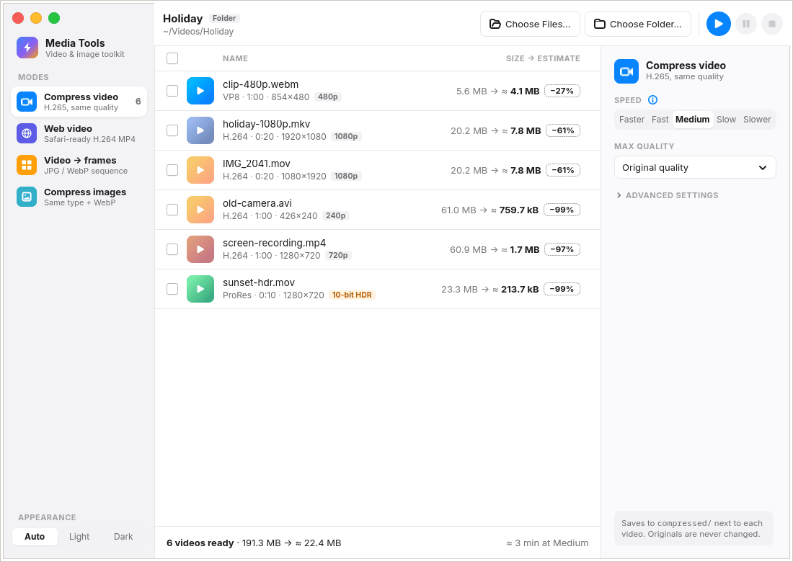
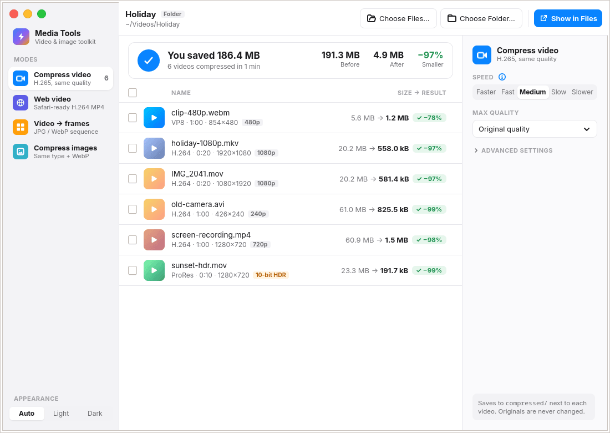
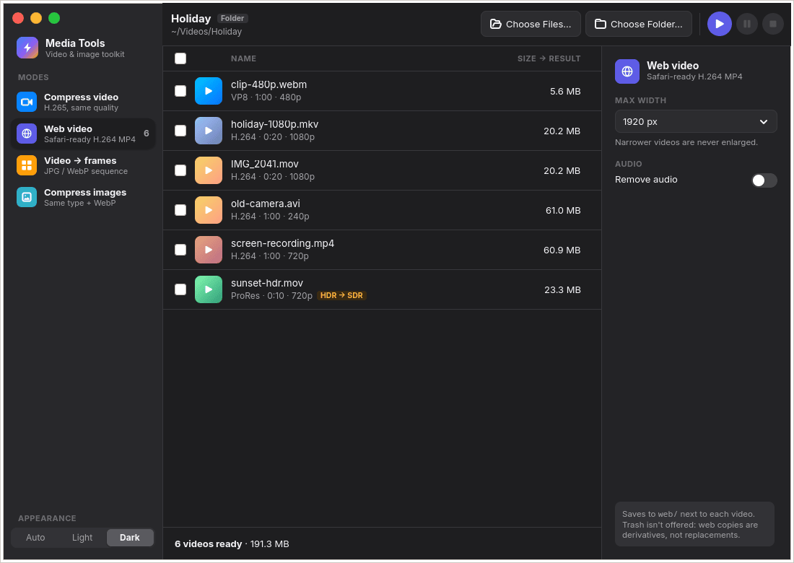

# Media Tools

Make videos and images smaller, offline, on Linux. Pick some files or a whole folder and press Start. The results go into
a new folder next to the originals, and the originals are never changed.



## Modes

| Mode | Output | Saved to |
|---|---|---|
| **Compress video** | H.265 at a quality chosen from VMAF measurements, with optional fast GPU (VA-API) encoding | `compressed/` |
| **Web video** | H.264 MP4 that starts playing in any browser, Safari included, before it has fully downloaded | `web/` |
| **Video → frames** | A video's frames as JPEG or WebP images, for a time range you pick | a folder per video |
| **Compress images** | Smaller JPEG, PNG and WebP files, plus a WebP copy of each image | `compressed/` |

- Each row shows an estimate of the output size before you start. With a working GPU the estimate comes from short
  sample encodes, not a formula.
- Phone metadata, rotation and HDR colour are kept. Web video converts HDR to SDR so it looks right in browsers.
- When you ask for it, originals go to the Trash, but only after the copy has been checked and confirmed smaller.
- Pause, stop, or close the window and let the work finish in the background. The computer won't suspend mid-job.





*The screenshots use generated test clips, which compress far better than real footage. Typical phone recordings shrink
by 70–85%; files that were already encoded efficiently shrink much less, and the app tells you so.*

## Install

Download `media-tools-*.flatpak` from [Releases](https://github.com/Tharindu-Dasantha/Personal-Tools/releases) and
double-click it, or run `flatpak install --user media-tools-*.flatpak`. The bundle includes ffmpeg (with x265),
ImageMagick and pngquant, so nothing else is needed. If Flatpak isn't set up yet, follow <https://flathub.org/setup>
first.

## Build

```sh
cmake -S "Video Compressor" -B "Video Compressor/build"
cmake --build "Video Compressor/build" -j
ctest --test-dir "Video Compressor/build" --output-on-failure
"Video Compressor/build/video-compressor"
```

Run these from the repo root. Dependencies for each distro, the sanitizer build and the Flatpak build are in
[CONTRIBUTING.md](../CONTRIBUTING.md).

## How it was designed

The design history is in [docs/](docs/). [docs/SPEC.md](docs/SPEC.md) and the `SPEC-*.md` files say how each mode
behaves, and [docs/LOG.md](docs/LOG.md) records the decisions and the measurements behind them, such as the VMAF
comparison of x265 presets and the GPU encoder on real clips.

## License

[GPL-3.0-or-later](../LICENSE). The embedded Inter font is under the SIL Open Font License
([data/fonts/Inter-LICENSE.txt](data/fonts/Inter-LICENSE.txt)).
